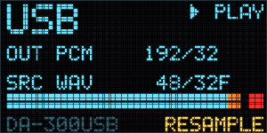

# DA-300 Display

A Windows tray app that shows what the Denon DA-300USB's front panel would tell you (input, format, sample rate) as an OLED-style overlay, plus a level meter with a clip LED.

## What it does

The panel shows whether the DAC is connected over USB and whether it is playing or idle. It notices WASAPI exclusive mode and ASIO, and names the app that is holding the DAC. For the output it shows PCM sample rate and bit depth, and native DSD or DoP (DSD64 and DSD128).

It also reads the file being played and shows its sample rate and bit depth (or bitrate for lossy files). That works for FLAC, WAV, AIFF, ALAC, AAC, MP3, Ogg Vorbis, Opus, DSF and DFF, with a RATE OK or RESAMPLE flag next to it.

The level meter has left and right peak bars with peak hold, and a red clip LED that only lights when the signal reaches full scale. It works in Windows shared mode, WASAPI exclusive and ASIO. For exclusive and ASIO playback in foobar2000 there is a small foobar2000 component that keeps the meter going.

The panel comes in four sizes, can be dragged anywhere, can stay on screen or pop up briefly when the format changes. The tray icon shows the current sample rate, colored by mode. You can switch the Windows output rate from the menu, or have the app match it to the file being played.

## Requirements

Windows 10 or 11 (64-bit) and a Denon DA-300USB on USB with the Denon USB Audio driver installed. foobar2000 v2 (64-bit) is optional, only for metering in exclusive and ASIO mode.

## Installation

Grab the [latest release](../../releases/latest). Run `DA300Display-Setup.exe` to install for the current user (no administrator rights needed). It adds a Start menu entry and installs the foobar2000 component if foobar2000 v2 is found. Uninstall from Settings > Apps.

Or unzip `DA300Display-1.0.0.zip` anywhere and run `DA300Display.exe`. For foobar2000 metering, double-click `foo_da300display.fb2k-component`.

The files aren't code-signed, so SmartScreen or a browser's download filter may complain. On SmartScreen choose More info, then Run anyway. If the installer gets blocked, use the zip.

## Usage

Left-click the tray icon to show or hide the panel, right-click it for the menu. Drag the panel to move it, right-click the panel to hide it. The menu has panel size, always show panel, reset panel position, pop up on changes, Windows output rate, auto-match output rate, and start with Windows.

## Limitations

The input selector and the headphone volume knob live inside the DAC and aren't reported over USB, so the panel can't show them. The coaxial and optical inputs aren't visible to the PC at all. There is no level meter for native DSD output, or for exclusive and ASIO playback from apps other than foobar2000. In ASIO mode the output sample rate is only shown for foobar2000.

## Building

You need the foobar2000 SDK 2025-03-07 unpacked to `foobar/sdk` (https://www.foobar2000.org/SDK) and Visual Studio 2026 with the C++ tools (toolset v145), both only for the component. The app and installer build with the .NET Framework `csc.exe` that ships with Windows. Then run `build.ps1`.

`DA300Display.cs` is the app, `installer/Setup.cs` the installer, `foobar/sdk/foobar2000/foo_da300display/` the component, and `releases/vX.Y.Z/` holds the tested builds with SHA-256 checksums.

Versions are major.minor.patch and only builds I've accepted as final get one. Work in progress shows the last release followed by DEV, for example V1.0.0 DEV.

## License

Source-available: free to view and to use personally; redistribution and modified versions need permission. See [LICENSE](LICENSE).

Denon and DA-300USB are trademarks of their owner. This project isn't affiliated with, endorsed by or sponsored by Denon.
